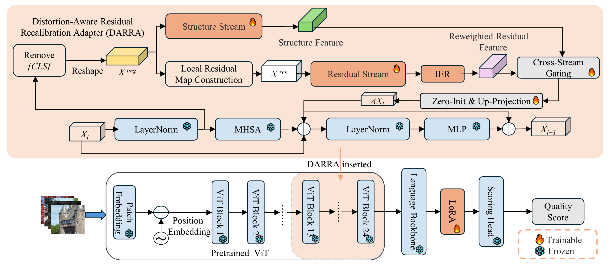

# DARRA-IER

Official implementation of **DARRA: A Distortion-Aware Residual Recalibration Adapter for MLLM-based No-Reference Image Quality Assessment**.

**Paper:** *Signal Processing*, 251 (2027), 110859 · [DOI: 10.1016/j.sigpro.2026.110859](https://doi.org/10.1016/j.sigpro.2026.110859)

DARRA adapts the mPLUG-Owl2 vision encoder (blocks 13–24) for no-reference image quality assessment. We used **8 × NVIDIA RTX 4090 GPUs for full fine-tuning**. A separate **2 × RTX 4090 LoRA fine-tuning** configuration is also available as a more resource-efficient implementation.

## Setup

Python 3.10, CUDA and a compatible PyTorch environment are required.

## Prepare data

For KonIQ, SPAQ and KADID10K, prepare `split.json` and `mos.json`, adjust `build_soft_labels/config.json`, and generate labels:

## Framework

*Overview of DARRA. The distortion-aware residual recalibration adapter is inserted into ViT blocks 13–24, incorporating structure and residual streams, inverted energy reweighting (IER), and cross-stream gating.*
  

## Training

We used two training configurations:

| Configuration | Hardware | Training mode |
| --- | --- | --- |
| **Full fine-tuning (used in our experiments)** | **8 × NVIDIA RTX 4090** | Full-parameter fine-tuning |
| **LoRA fine-tuning** | **2 × NVIDIA RTX 4090** | DARRA + language LoRA, with the pretrained backbone frozen |

### LoRA: 2 × RTX 4090

The following command uses the **LoRA training entrypoint currently included in this repository**:

Default LoRA rank is **64** (alpha **128**); the effective global batch size is **64**. Actual memory use depends on the environment.

### Full fine-tuning: 8 × RTX 4090

**Full fine-tuning was carried out on 8 × RTX 4090 GPUs**

## Inference & evaluation

Evaluation metrics include **SRCC, PLCC, KRCC, MAE, and RMSE**. Ensure that ground-truth MOS and predictions use consistent score scales and directions.

## Citation

If you use this work, please cite:

> T. Wang, H. Luo, C. Yang, and H. Jia, “DARRA: A distortion-aware residual recalibration adapter for MLLM-based no-reference image quality assessment,” *Signal Processing*, vol. 251, art. 110859, 2027. https://doi.org/10.1016/j.sigpro.2026.110859

